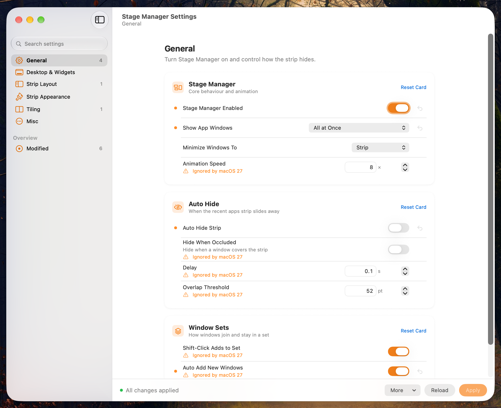

# StagemanTool

StagemanTool is a SwiftUI control panel for macOS's Stage Manager. It exposes the hidden
`com.apple.WindowManager` preferences (strip layout, spacing, shadows, animation speed, tiling
and more) so you can tweak them without typing `defaults write` commands by hand.



## Features

- Settings grouped into sections in a sidebar, with search
- A **Modified** view listing every key you've overridden
- Unsaved-change counter; nothing is written until you click **Apply**
- Per-setting revert (↶) to delete an override and fall back to the system default
- Hover any row to see its raw defaults key
- Force-enable Stage Manager, or reset every WindowManager preference
- Keys that only exist on newer releases are shown only on macOS 27 and later

## Requirements

- macOS 15.7 or later
- Xcode with the macOS 15.7+ SDK

## Build & Run

Open `StagemanTool.xcodeproj` in Xcode, choose **My Mac** as the destination, and run.

Or build a Release app from the command line:

```bash
./build.sh
```

The app is copied to `build/StagemanTool.app`. Set `CONFIGURATION=Debug` to build Debug instead.

## Usage

| Action | Shortcut | What it does |
|---|---|---|
| **Apply** | ⌘S | Writes pending changes with `defaults write`, then restarts WindowManager and the Dock |
| **Reload** | ⌘R | Re-reads current values from the system, discarding unsaved edits |
| **More → Force Enable Stage Manager** | | Sets `GloballyEnabled` to true |
| **More → Reset All…** | | Deletes the whole `com.apple.WindowManager` domain and restarts Stage Manager and the Dock (asks for confirmation) |

> Applying or resetting kills `WindowManager` and `Dock`, so your windows and Dock will briefly
> redraw.

## Supported Keys

All keys live in the `com.apple.WindowManager` defaults domain. They were extracted from the
`WindowManagerPreferences` table in `WindowManager.framework` (dyld shared cache, macOS 27.2);
some may be ignored on other macOS versions. See [docs/macos27-key-map.md](docs/macos27-key-map.md)
for details.

| Section | Keys |
|---|---|
| General | GloballyEnabled, AppWindowGroupingBehavior, AutoHide, AutoHideWhenOccluded, AutoHideDelay, AutoHideOverlapThreshold, AnimationSpeed, ShiftClickToAddToSet, ShouldPersistLeftStripOrdering, EnableAutomaticNewWindowAddToWindowSet |
| Desktop & Widgets | HideDesktop, StandardHideDesktopIcons, StageManagerHideWidgets, StandardHideWidgets, EnableStandardClickToShowDesktop, EnableStageManagerClickToEmptyStage |
| Strip Layout | LeftStripMaximumRowCount, LeftStripMinimumRowCount, LeftStripPileMaximumWindowCount, LeftStripPileVerticalSpacing, LeftStripPileInterItemHorizontalSpacing, LeftStripEdgeHorizontalInset, HorizontalInset, StageFrameMinimumHorizontalInset, HiddenStripPeekWidth, MaximumItemHeight, PreferredMinimumItemHeight, ItemWidth, InterItemVerticalSpacing, InterItemHorizontalSpacing, AppIconSize, LeftStripAppIconLeftOffset, LeftStripAppIconBottomOffset |
| Strip Appearance | EnableStripShadows, StripWindowShadowDensityMultiplier, EnableStripCornerRadius, StripCornerRadius, EnableStrip3DTransform, PilePerspectiveDistance, LeftStripStackDepthStepValue, StripHoverScaleDistance, AppIconHoverScaleDistance |
| Tiling | EnableTilingByEdgeDrag, EnableTopTilingByEdgeDrag, EnableTilingOptionAccelerator, EnableTiledWindowMargins, TiledWindowSpacing, TilingHotzoneDelay, ShowTiledWindowBorder, DisableTilingAnimations |
| Misc | EnableShowDesktop, EnableMissionControl, EnableAppExpose, SlowAnimationsWhileShiftHeld |

To undo everything manually:

```bash
defaults delete com.apple.WindowManager && killall WindowManager Dock
```

## Project Structure

```
StagemanTool/
├── StagemanToolApp.swift       App entry point
├── ContentView.swift           Split view: sidebar, search, detail pane
├── WindowManagerService.swift  Setting catalog, defaults read/write, process restarts
├── Views/
│   ├── SidebarView.swift       Section list and Modified view
│   ├── SectionPane.swift       Settings for the selected section
│   ├── SettingsCard.swift      Grouped card container
│   ├── SettingRow.swift        Single setting control with revert button
│   └── ActionBar.swift         Status, Apply / Reload / More menu
└── Assets.xcassets             App icon and accent color
build.sh                        Command-line Release build
docs/                           Screenshot and key reference
```

## Disclaimer

These are undocumented Apple preferences. They can change or disappear in any macOS update.
This project is for personal use and experimentation, with no warranty.

---

Created by F7urry
